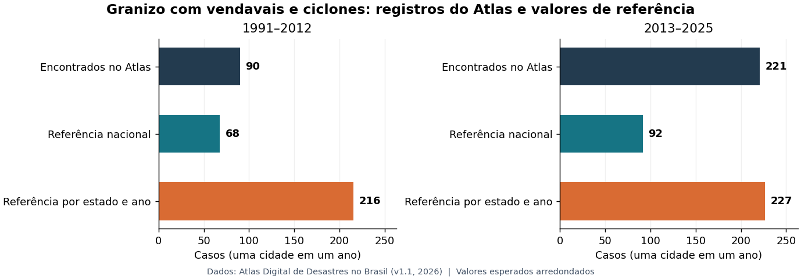
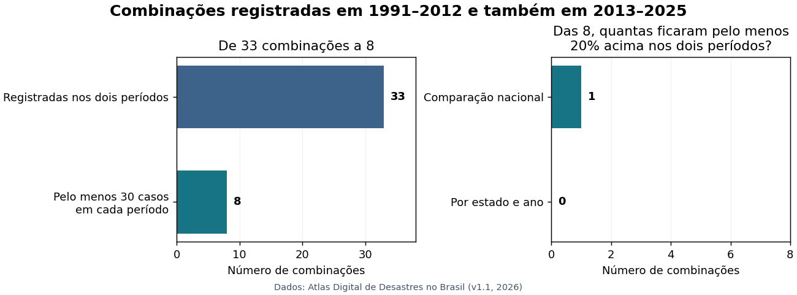
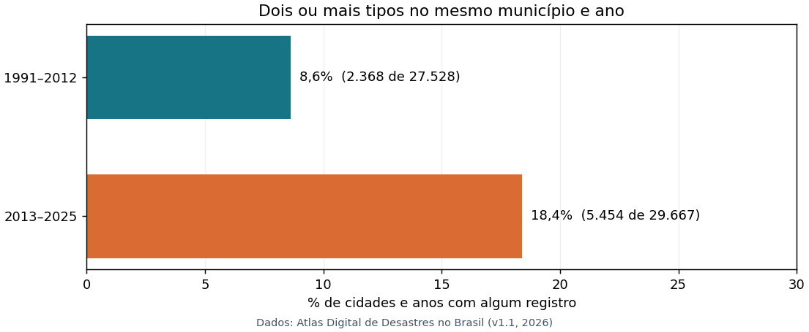
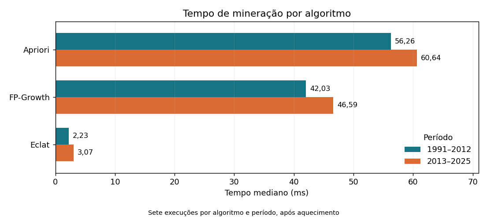

# Brasil sobre Impacto 2

[Notebook original (.ipynb)](Brasil_sob_Impacto.ipynb)

Esta página mostra os resultados salvos. Para recalcular a análise, use o projeto completo com os scripts e os dados.

Mineração de Dados · Atividade 2 · Regras de associação

**Integrantes:** Felipe Cintra Silva, Ítalo Dias Moreira Campos e Rakel Garcia da Silva.

### Pergunta

**Quais tipos de desastre são registrados juntos no mesmo município e ano, e quais dessas combinações se repetem nos dois períodos do Atlas, de 1991–2012 e de 2013–2025?**

### Resposta à pergunta

**Chuva e processos hidrológicos com estiagem e seca** foi a combinação mais frequente nos dois períodos: **1.098 casos** entre **1991 e 2012** e **2.040** entre **2013 e 2025**.

**Granizo com vendavais e ciclones** apareceu em **90 casos** no primeiro período e **221** no segundo. Foi a única combinação que ficou pelo menos 20% acima da referência nacional nos dois períodos. Quando levamos em conta onde e em que ano os dois tipos costumam ser registrados, esse excesso desapareceu.

**O que conta como um caso?** Se uma cidade registrou granizo em março de 2021 e vendaval em novembro de 2021, contamos **um caso** dessa combinação naquela cidade e naquele ano.

### Quais foram as oito combinações?

Ao todo, **33 combinações** apareceram nos dois períodos. A tabela mostra as **oito** que apareceram em **pelo menos 30 casos entre 1991 e 2012 e pelo menos 30 entre 2013 e 2025**.

<table border="1" class="dataframe">
  <thead>
    <tr style="text-align: right;">
      <th></th>
      <th>Casos em 1991–2012</th>
      <th>Casos em 2013–2025</th>
    </tr>
    <tr>
      <th>Tipos de desastre registrados juntos</th>
      <th></th>
      <th></th>
    </tr>
  </thead>
  <tbody>
    <tr>
      <th>Chuva e processos hidrológicos + Estiagem e Seca</th>
      <td>1098</td>
      <td>2040</td>
    </tr>
    <tr>
      <th>Chuva e processos hidrológicos + Vendavais e Ciclones</th>
      <td>408</td>
      <td>1187</td>
    </tr>
    <tr>
      <th>Estiagem e Seca + Vendavais e Ciclones</th>
      <td>314</td>
      <td>587</td>
    </tr>
    <tr>
      <th>Chuva e processos hidrológicos + Granizo</th>
      <td>181</td>
      <td>511</td>
    </tr>
    <tr>
      <th>Chuva e processos hidrológicos + Movimento de Massa</th>
      <td>169</td>
      <td>433</td>
    </tr>
    <tr>
      <th>Estiagem e Seca + Granizo</th>
      <td>173</td>
      <td>222</td>
    </tr>
    <tr>
      <th>Granizo + Vendavais e Ciclones</th>
      <td>90</td>
      <td>221</td>
    </tr>
    <tr>
      <th>Chuva e processos hidrológicos + Erosão</th>
      <td>64</td>
      <td>195</td>
    </tr>
  </tbody>
</table>

### O que significa «esperado» no gráfico?

É um **número de referência calculado com os dados do Atlas**. Usamos a frequência de cada tipo para estimar quantas vezes eles apareceriam juntos se ocorressem de forma independente. Por exemplo, se em 100 cidades-ano um tipo aparece em 10% e o outro em 20%, a referência é 2 cidades-ano com os dois (10% × 20% × 100).

Em **2013–2025**, encontramos **221** casos no Atlas. Se usamos as frequências do país inteiro, a conta de referência dá cerca de **92**. Se usamos as frequências de cada estado (ou Distrito Federal) em cada ano e somamos os resultados, a referência sobe para **227**, perto dos 221 encontrados.

    

    

### O resumo em quatro números

**33** combinações apareceram nos dois períodos. **8** tiveram pelo menos 30 casos em cada período e estão na tabela acima. Entre essas mesmas oito, **1** ficou pelo menos 20% acima da referência nacional nos dois períodos (granizo com vendavais e ciclones). Com a referência por estado e ano, **0** chegou a esse limite nos dois períodos.

    

    

### Origem e qualidade dos dados

Importamos no Jupyter a base tratada da Atividade 1, derivada do **Atlas Digital de Desastres no Brasil, v1.1**. Ela tem **76.190 protocolos**. Conferimos os códigos municipais no IBGE, o preenchimento dos campos usados, as datas e as duplicatas. Na tabela, os 180 registros com município, data e tipo iguais têm protocolos distintos. A análise conta uma única presença de cada tipo por cidade e ano.

**Ano do desastre e ano de cadastro.** O período é definido pela data em que o desastre aconteceu. Assim, **88 protocolos cadastrados em 2026** entram em 2025 porque os eventos ocorreram em 2025. Em outros 12 casos, a data de cadastro aparece antes da data do evento. Essa inconsistência está indicada na tabela.

Separamos **1991–2012** e **2013–2025** porque a forma de registrar mudou com a adoção do Sistema Integrado de Informações sobre Desastres (S2ID). O guia do projeto completo mostra onde estão a base original e a tratada e descreve o preparo. Na figura de cobertura, o percentual considera apenas cidades e anos com algum registro no Atlas.

<table border="1" class="dataframe">
  <thead>
    <tr style="text-align: right;">
      <th></th>
      <th>Protocolos</th>
      <th>Município-anos</th>
      <th>Com 2+ categorias comparáveis</th>
      <th>Pares em destaque</th>
    </tr>
    <tr>
      <th>Período</th>
      <th></th>
      <th></th>
      <th></th>
      <th></th>
    </tr>
  </thead>
  <tbody>
    <tr>
      <th>1991–2012</th>
      <td>31590</td>
      <td>27528</td>
      <td>2368</td>
      <td>1</td>
    </tr>
    <tr>
      <th>2013–2025</th>
      <td>44600</td>
      <td>29667</td>
      <td>5454</td>
      <td>20</td>
    </tr>
  </tbody>
</table>

<table border="1" class="dataframe">
  <thead>
    <tr style="text-align: right;">
      <th></th>
      <th>Quantidade</th>
    </tr>
  </thead>
  <tbody>
    <tr>
      <th>Protocolos distintos</th>
      <td>76190</td>
    </tr>
    <tr>
      <th>Linhas integralmente duplicadas</th>
      <td>0</td>
    </tr>
    <tr>
      <th>Campos vazios entre os usados</th>
      <td>0</td>
    </tr>
    <tr>
      <th>Outras colunas com vazios</th>
      <td>6</td>
    </tr>
    <tr>
      <th>Registros com o mesmo município, data e tipo</th>
      <td>180</td>
    </tr>
    <tr>
      <th>Protocolos cuja data de registro é anterior à do evento</th>
      <td>12</td>
    </tr>
    <tr>
      <th>Eventos de 2025 registrados em 2026</th>
      <td>88</td>
    </tr>
    <tr>
      <th>Códigos de municípios conferidos no IBGE</th>
      <td>5256</td>
    </tr>
  </tbody>
</table>

    

    

### Como medimos as combinações

Para cada cidade e ano com algum registro, marcamos os tipos que apareceram. Três registros de granizo no mesmo ano e na mesma cidade contam como uma presença de granizo. Para comparar os períodos, reunimos chuvas intensas, enxurradas, inundações e alagamentos em **Chuva e processos hidrológicos**. Onda de calor e baixa umidade aparece só no período recente e ficou fora da comparação entre tipos. A análise principal usa **12 categorias**.

#### Como ler os números de granizo com vendavais

| Medida | O que significa | Exemplo em 2013–2025 |
| --- | --- | --- |
| **Suporte** | Entre todas as cidades e anos com algum registro, qual porcentagem teve os dois tipos? | **0,74%**. Foram 221 de 29.667. |
| **Confiança** | Entre as cidades e anos com granizo, qual porcentagem também teve vendavais e ciclones? | **19,45%**. Cerca de 19 em cada 100 com granizo. |
| **Lift** | Dividimos a quantidade de casos encontrados pela quantidade esperada. | **2,41**. Houve cerca de 2,4 vezes o esperado pela comparação nacional. |

Para entrar na seleção, a combinação precisava aparecer em pelo menos **30 casos em cada período**. Para ganhar destaque, precisava ainda ficar **20% ou mais acima da referência** nos dois períodos (lift de pelo menos **1,20**).

<table border="1" class="dataframe">
  <thead>
    <tr style="text-align: right;">
      <th></th>
      <th>Casos com os dois tipos</th>
      <th>Suporte</th>
      <th>Confiança (entre casos com granizo)</th>
      <th>Lift nacional</th>
    </tr>
    <tr>
      <th>Período</th>
      <th></th>
      <th></th>
      <th></th>
      <th></th>
    </tr>
  </thead>
  <tbody>
    <tr>
      <th>1991–2012</th>
      <td>90</td>
      <td>0,33%</td>
      <td>8,77%</td>
      <td>1,33</td>
    </tr>
    <tr>
      <th>2013–2025</th>
      <td>221</td>
      <td>0,74%</td>
      <td>19,45%</td>
      <td>2,41</td>
    </tr>
  </tbody>
</table>

### Por que o resultado muda quando olhamos por estado e ano?

A contagem de **221 casos** de granizo com vendavais e ciclones em 2013–2025 permanece igual. O que muda é quanto esperamos encontrar juntos. Primeiro, usamos a frequência de cada tipo no Brasil inteiro. Depois, repetimos a conta para cada estado ou Distrito Federal e ano, e somamos os valores esperados.

No período recente, dividimos os 221 casos observados pelo número esperado. Com os valores completos, o resultado é **2,41** pela comparação nacional e **0,97** pela comparação por estado e ano. Um resultado de **1** significa que o número encontrado é igual ao esperado. O gráfico arredonda os números esperados para facilitar a leitura. No primeiro período, a razão cai de **1,33** para **0,42**. O Sul concentrou **79 dos 90 casos** no histórico e **187 dos 221** no período recente.

Das **33 combinações** registradas nos dois períodos, **oito** apareceram em pelo menos 30 casos em cada um. Pela comparação nacional, só granizo com vendavais e ciclones passou do limite de 20% acima do esperado nos dois períodos. Na comparação por estado e ano, nenhuma das oito passou desse limite nos dois períodos.

Também repetimos a análise com os **4.413 municípios** presentes nos períodos completos, com os **4.264 municípios** presentes nas duas janelas exatas de 13 anos e sem os registros de 2024. A interpretação se manteve. Quando examinamos os tipos de chuva separadamente, alagamentos e movimento de massa também se destacaram na comparação nacional.

<table border="1" class="dataframe">
  <thead>
    <tr style="text-align: right;">
      <th></th>
      <th>Duplas em destaque nos dois períodos</th>
      <th>Dupla em destaque</th>
    </tr>
    <tr>
      <th>Mínimo de casos por período</th>
      <th></th>
      <th></th>
    </tr>
  </thead>
  <tbody>
    <tr>
      <th>15</th>
      <td>1</td>
      <td>Granizo + vendavais e ciclones</td>
    </tr>
    <tr>
      <th>30</th>
      <td>1</td>
      <td>Granizo + vendavais e ciclones</td>
    </tr>
    <tr>
      <th>50</th>
      <td>1</td>
      <td>Granizo + vendavais e ciclones</td>
    </tr>
  </tbody>
</table>

<table border="1" class="dataframe">
  <thead>
    <tr style="text-align: right;">
      <th></th>
      <th>Casos com os dois tipos</th>
      <th>Lift geral</th>
      <th>Razão por UF e ano</th>
    </tr>
  </thead>
  <tbody>
    <tr>
      <th>1991–2012</th>
      <td>90.0</td>
      <td>1.33</td>
      <td>0.42</td>
    </tr>
    <tr>
      <th>2013–2025</th>
      <td>221.0</td>
      <td>2.41</td>
      <td>0.97</td>
    </tr>
    <tr>
      <th>Municípios em ambos · 1991–2012</th>
      <td>90.0</td>
      <td>1.39</td>
      <td>0.43</td>
    </tr>
    <tr>
      <th>Municípios em ambos · 2013–2025</th>
      <td>221.0</td>
      <td>2.47</td>
      <td>1.01</td>
    </tr>
    <tr>
      <th>Janelas de 13 anos · 2000–2012</th>
      <td>73.0</td>
      <td>1.32</td>
      <td>0.44</td>
    </tr>
    <tr>
      <th>Janelas de 13 anos · 2013–2025</th>
      <td>221.0</td>
      <td>2.47</td>
      <td>1.01</td>
    </tr>
    <tr>
      <th>2013–2025, sem 2024</th>
      <td>206.0</td>
      <td>2.36</td>
      <td>0.95</td>
    </tr>
    <tr>
      <th>2013–2025, sem RS em 2024</th>
      <td>209.0</td>
      <td>2.39</td>
      <td>0.94</td>
    </tr>
  </tbody>
</table>

<table border="1" class="dataframe">
  <thead>
    <tr style="text-align: right;">
      <th></th>
      <th></th>
      <th>Juntos</th>
      <th>Lift</th>
      <th>Observado / esperado por UF e ano</th>
    </tr>
    <tr>
      <th>Dupla</th>
      <th>Período</th>
      <th></th>
      <th></th>
      <th></th>
    </tr>
  </thead>
  <tbody>
    <tr>
      <th rowspan="2" valign="top">Alagamentos + Movimento de Massa</th>
      <th>1991–2012</th>
      <td>35</td>
      <td>4.17</td>
      <td>0.81</td>
    </tr>
    <tr>
      <th>2013–2025</th>
      <td>151</td>
      <td>4.11</td>
      <td>2.02</td>
    </tr>
    <tr>
      <th rowspan="2" valign="top">Granizo + Vendavais e Ciclones</th>
      <th>1991–2012</th>
      <td>90</td>
      <td>1.33</td>
      <td>0.42</td>
    </tr>
    <tr>
      <th>2013–2025</th>
      <td>221</td>
      <td>2.41</td>
      <td>0.97</td>
    </tr>
  </tbody>
</table>

### Comparação dos algoritmos

Testamos **Apriori, FP-Growth e Eclat** com a mesma base e a mesma regra de seleção. Apriori filtra as combinações possíveis, FP-Growth organiza os registros em uma árvore e Eclat cruza as listas de cidades e anos de cada tipo.

Os três encontraram **as mesmas combinações**: 8 em 1991–2012 e 34 em 2013–2025, considerando o mínimo de 30 casos em cada período separadamente. As 8 da tabela de abertura são as que passaram pelo mínimo **nos dois períodos**. Conferimos as contagens diretamente na base de análise.

Como os resultados foram iguais, comparamos o **tempo de mineração**. Rodamos cada algoritmo sete vezes por período após uma rodada de aquecimento. A **mediana** é o tempo que fica no meio das sete medições. Q1 e Q3 mostram a faixa que contém a metade central dos tempos. Quanto menor a barra, mais rápido foi o algoritmo neste teste.

<table border="1" class="dataframe">
  <thead>
    <tr style="text-align: right;">
      <th></th>
      <th></th>
      <th>Mediana (ms)</th>
      <th>Q1 (ms)</th>
      <th>Q3 (ms)</th>
      <th>Repetições</th>
      <th>Duplas com 30+ município-anos</th>
    </tr>
    <tr>
      <th>Período</th>
      <th>Algoritmo</th>
      <th></th>
      <th></th>
      <th></th>
      <th></th>
      <th></th>
    </tr>
  </thead>
  <tbody>
    <tr>
      <th rowspan="3" valign="top">1991–2012</th>
      <th>Apriori</th>
      <td>56.26</td>
      <td>55.80</td>
      <td>57.19</td>
      <td>7</td>
      <td>8</td>
    </tr>
    <tr>
      <th>FP-Growth</th>
      <td>42.03</td>
      <td>41.62</td>
      <td>43.48</td>
      <td>7</td>
      <td>8</td>
    </tr>
    <tr>
      <th>Eclat</th>
      <td>2.23</td>
      <td>2.14</td>
      <td>2.27</td>
      <td>7</td>
      <td>8</td>
    </tr>
    <tr>
      <th rowspan="3" valign="top">2013–2025</th>
      <th>Apriori</th>
      <td>60.64</td>
      <td>60.34</td>
      <td>60.98</td>
      <td>7</td>
      <td>34</td>
    </tr>
    <tr>
      <th>FP-Growth</th>
      <td>46.59</td>
      <td>46.16</td>
      <td>47.38</td>
      <td>7</td>
      <td>34</td>
    </tr>
    <tr>
      <th>Eclat</th>
      <td>3.07</td>
      <td>2.94</td>
      <td>3.13</td>
      <td>7</td>
      <td>34</td>
    </tr>
  </tbody>
</table>

    

    

**Eclat foi a melhor opção neste teste.** Entregou os mesmos resultados e teve a menor mediana de tempo nos dois períodos. A escolha vale para este conjunto com poucas categorias, para pares e para as implementações que usamos. Os tempos podem variar em outra máquina ou em um problema maior.

### Limites da análise

O Atlas reúne registros administrativos. O resultado depende de quais desastres foram registrados, de como foram classificados e de onde e quando os registros se concentram. As medidas descrevem os municípios nos anos em que tiveram algum registro no Atlas. A comparação por UF e ano leva em conta o contexto dos registros, mas ainda pode reunir municípios com exposições diferentes. A análise aponta duplas para investigar. Para saber se os registros vieram do mesmo episódio ou se um tipo de desastre contribuiu para outro, precisaríamos de outras informações.

Mostramos resultados agregados e usamos a versão tratada da Atividade 1, da qual já foram retirados os campos de descrição livre. Usamos os números de protocolo para verificar a qualidade dos dados.

### Avaliação do Jupyter Notebook

Fizemos a mineração em **Python** e usamos o **Jupyter Notebook** para organizar, executar e apresentar a análise. As tabelas geradas com pandas facilitaram a conferência das contagens. Os gráficos do Matplotlib ajudaram a comparar os períodos e os tempos dos três algoritmos. Para a leitura, podemos recolher o código e deixar as saídas visíveis.

O principal cuidado para repetir a análise é escolher o ambiente Python do projeto e executar as células em ordem. As primeiras preparam os dados que as demais usam. Para conferir a reprodução, reiniciamos o kernel do projeto e executamos as cinco células de código. Os três algoritmos voltaram a encontrar 8 pares em 1991–2012 e 34 em 2013–2025. Eclat voltou a ter o menor tempo mediano. O guia de reprodução do projeto completo traz os passos para repetir o teste.

### Referências

- Material da disciplina *Mineração de Dados*, seção de regras de associação.
- [Manual de Aplicação do Atlas Digital](https://atlasdigital.mdr.gov.br/arquivos/Atlas_Digital_Desastres_Manual_Aplicacao.pdf), pp. 17–19, e [SINISA 2025, Águas Pluviais](https://www.gov.br/cidades/pt-br/acesso-a-informacao/acoes-e-programas/saneamento/sinisa/resultados-sinisa/RELATORIO_SINISA_AGUAS_PLUVIAIS_2025.pdf), pp. 42–44.
- [IBGE, Divisão Territorial Brasileira 2013](https://geoftp.ibge.gov.br/organizacao_do_territorio/estrutura_territorial/divisao_territorial/2013/) e [2025](https://geoftp.ibge.gov.br/organizacao_do_territorio/estrutura_territorial/divisao_territorial/2025/).
- [Agrawal e Srikant (1994), Apriori](https://www.vldb.org/conf/1994/P487.PDF), [Han et al. (2004), FP-Growth](https://doi.org/10.1023/B:DAMI.0000005258.31418.83) e [Zaki (2000), Eclat](https://www.cs.rpi.edu/~zaki/publications/).
